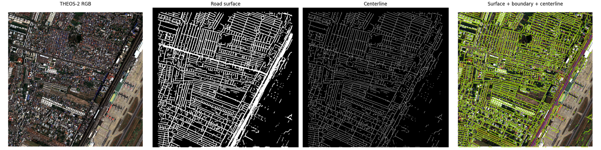
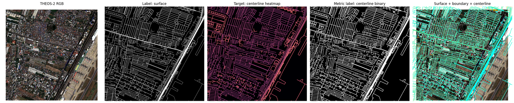
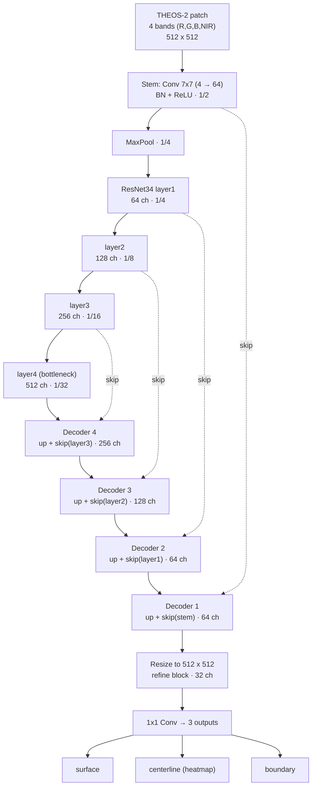
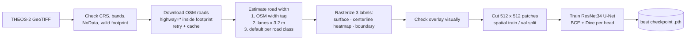
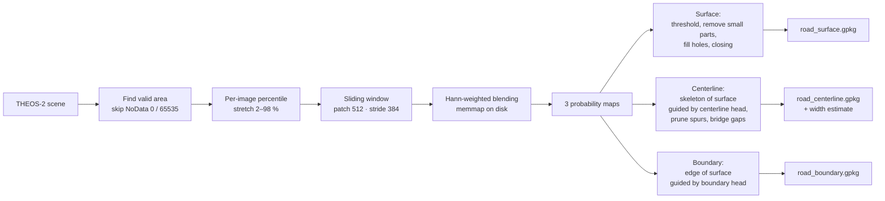

# Road Extraction from THEOS-2 (Surface + Centerline + Boundary)

Extract **roads** from **THEOS-2** very-high-resolution satellite images.
One model predicts **three things at once**:

1. **Road surface**: the road area (polygon)
2. **Road centerline**: the middle line of the road (line, with estimated width)
3. **Road boundary**: the road edges (line)

The results are exported as GeoPackage files that you can open directly in QGIS.

> **Note:** unlike my other repos, this model uses a **ResNet34 U-Net** (a classic CNN), not TerraMind.
> Roads are long and thin, often only a few pixels wide, so a CNN that works at full resolution is a strong baseline.
> You can compare it with the TerraMind repos to see when a foundation model helps and when a simple CNN is enough.

---

## What you get

| Notebook | What it does |
|---|---|
| [`01_finetune_road_multitask.ipynb`](notebooks/01_finetune_road_multitask.ipynb) | Make labels from **OpenStreetMap** automatically → train the 3-head model |
| [`02_predict_road_full_scene.ipynb`](notebooks/02_predict_road_full_scene.ipynb) | Predict on a full THEOS-2 scene → GeoTIFF + GeoPackage |

**Output per image:**

```text
geotiff/
├── road_surface_probability.tif
├── road_centerline_probability.tif
├── road_boundary_probability.tif
├── road_surface_mask.tif
├── road_centerline_mask.tif
└── road_boundary_mask.tif

vector/
├── road_surface.gpkg      polygons of the road area
├── road_centerline.gpkg   lines + width_med_m, width_mean_m
└── road_boundary.gpkg     road edge lines
```

> **Not included:** the trained checkpoint and the THEOS-2 images.
> The road labels are **made automatically from OpenStreetMap**, so you only need your own images.

## Results

**Prediction on a full THEOS-2 scene** (output of `02_predict_road_full_scene.ipynb`)



From left to right: THEOS-2 RGB image, predicted road surface, predicted centerline, and all three outputs drawn on the image (surface, boundary and centerline).

**Training labels made automatically from OpenStreetMap** (output of `01_finetune_road_multitask.ipynb`)



From left to right: THEOS-2 RGB image, surface label, centerline heatmap target, centerline binary label, and all labels drawn on the image. The labels come from OSM, so some small roads are missing. The model can still learn from them.

---

## Model architecture



**Why 3 heads?** They help each other. The surface tells *where* the road is,
the centerline keeps the road *connected*, and the boundary makes the *edges* sharp.

---

## Training workflow (no manual labeling!)

Drawing roads by hand takes a long time. This notebook makes **weak labels** from **OpenStreetMap (OSM)** automatically.



| Setting | Default | Meaning |
|---|---|---|
| `PATCH_SIZE` / `PATCH_STRIDE` | 512 / 384 | 512 px = 256 m at 0.5 m resolution |
| `EPOCHS` | 30 | Training rounds |
| `BATCH_SIZE` | 4 | Patches per step |
| `LEARNING_RATE` | 1e-4 | AdamW |
| `USE_IMAGENET_PRETRAINED` | True | Start the encoder from ImageNet weights (NIR is added to the first layer) |
| `MAX_TILES_TOTAL` | 1200 | Increase this when you have more GPU time |
| `NEGATIVE_TO_POSITIVE_RATIO` | 0.35 | Some patches without roads, so the model learns "not road" too |
| `CENTERLINE_HEATMAP_SIGMA_M` | 1.5 | The centerline is learned as a soft heatmap, not a 1-pixel line |
| `HEAD_LOSS_WEIGHTS` | surface 1.0 · centerline 1.5 · boundary 0.5 | How much each head counts |

**Checkpoint selection score** = `0.60 × Surface Dice + 0.25 × Centerline Dice + 0.15 × Boundary Dice`

**Why a soft heatmap for the centerline?** A 1-pixel line is almost impossible to hit exactly, so the model learns nothing.
A soft "glow" around the line gives the model a target it can actually learn.

**Augmentation:** flips, 90° rotations and light brightness / contrast / gamma changes only.
No strong stretching, because that would change the road width.

>  OSM labels are **not perfect ground truth**. Some roads are missing or shifted, and the width is estimated.
> Treat the model as a strong prototype and check the results in QGIS.
> If the Overpass API (OSM server) is busy, the notebook retries and uses its local cache.

---

## Prediction workflow



---

## Quick start (Google Colab)

1. Open [`02_predict_road_full_scene.ipynb`](notebooks/02_predict_road_full_scene.ipynb) in Colab with a **GPU** runtime.
2. Edit **only** the paths cell:

```python
PROJECT_ROOT = DRIVE_ROOT / "GeoFM_Projects" / "Road_Extraction_THEOS2"

IMAGE_SOURCES = [
    DRIVE_ROOT / "THEOS2_images",       # folder or single .tif
]

CHECKPOINT_SOURCES = [
    PROJECT_ROOT / "checkpoints",       # a file with "best" in its name is chosen first
]

OUTPUT_ROOT = PROJECT_ROOT / "predictions"
```

3. Run all cells.
4. Open the `.gpkg` files in QGIS.

>  The notebook text is written in **Thai**, but the code is in English.

---

## Main settings (you can change these without training again)

| Setting | Default | Meaning |
|---|---|---|
| `STRIDE` | 384 | Window step (patch 512 → 25% overlap) |
| `BATCH_SIZE` | 6 | Patches per GPU step |
| `SURFACE_THRESHOLD` | 0.50 | Lower = wider and more complete roads |
| `CENTERLINE_PROBABILITY_THRESHOLD` | 0.35 | Guide for the centerline |
| `BOUNDARY_THRESHOLD` | 0.42 | Guide for the boundary |
| `MIN_ROAD_COMPONENT_PIXELS` | 80 | Remove small road pieces |
| `MAX_HOLE_PIXELS` | 500 | Fill small holes in roads |
| `MIN_CENTERLINE_SPUR_LENGTH_M` | 6.0 | Cut short side branches |
| `MAX_CENTERLINE_GAP_M` | 3.0 | Join broken lines when the gap is shorter than this |
| `MAX_ENDPOINT_ANGLE_DEGREES` | 25 | Only join lines that point in the same direction |
| `SIMPLIFY_TOLERANCE_M` | 0.50 | Smooth the output lines |

**Tip:** if the roads look too thick or too thin, change the thresholds and run again from *Session 7*.
You do not need to load the model again.

---

## Checkpoint format

The prediction notebook expects a PyTorch `.pth` file like this:

```python
{
    "architecture_version": "road_resnet34_unet_centerline_v2",
    "model_state_dict": ...,
    "epoch": ...,
    "best_score": ...,
    "config": {
        "band_indexes": [1, 2, 3, 4],
        "head_names": ["surface", "centerline", "boundary"],
        "patch_size": 512,
        "in_channels": 4,
        "out_channels": 3,
    },
}
```

The notebook checks `architecture_version` before loading, so a wrong model is never loaded silently.

---

## Use this for your own project

- **Other high-resolution imagery** (drone, other satellites)? Change `BAND_INDEXES` and retrain.
- **RGB only?** Set `in_channels=3`.
- **Want to try TerraMind?** Replace the ResNet34 encoder with a TerraMind backbone + a local CNN branch (see the *building footprint* repo for an example of this hybrid design).

---

## Common problems

| Problem | Fix |
|---|---|
| `Checkpoint is not Centerline V2` | The checkpoint is from an older version. Retrain with the heatmap centerline target |
| Roads are broken | Lower `SURFACE_THRESHOLD` or raise `MAX_CENTERLINE_GAP_M` |
| Too many small lines | Raise `MIN_CENTERLINE_SPUR_LENGTH_M` / `MIN_ROAD_COMPONENT_PIXELS` |
| Visible lines between tiles | Use a smaller `STRIDE` (more overlap) |
| RAM full | The notebook already uses memmap. Process fewer images at once |

---

## Learn more

- [Beginner's guide to GeoFM and TerraMind](docs/GEOFM_BEGINNER_GUIDE.md)
- OSMnx (download OSM roads): https://osmnx.readthedocs.io/en/stable/
- Rasterio windowed reading: https://rasterio.readthedocs.io/en/stable/topics/windowed-rw.html
- Rasterio features (polygonize): https://rasterio.readthedocs.io/en/stable/topics/features.html
- torchvision ResNet34: https://docs.pytorch.org/vision/stable/models/generated/torchvision.models.resnet34.html

## Related repos

Part of my geospatial foundation model series:
- [Building footprint (THEOS-2)](https://github.com/mastersungx1/terramind-building-footprint-theos2)
- [Rice mapping (Sentinel-2 time series)](https://github.com/mastersungx1/terramind-rice-mapping-sentinel2)
- [Flood mapping (Sentinel-1 + 2)](https://github.com/mastersungx1/terramind-flood-mapping-sen1floods11)
- [Road extraction (THEOS-2)](https://github.com/mastersungx1/theos2-road-extraction-multitask)

## Acknowledgement

Developed during my internship at **I-bitz (Insight)**. Thank you to the team for the support and for allowing me to share this work.
The company's data, labels and trained checkpoints are **not** part of this repository.

## License

Code: [MIT](LICENSE).
