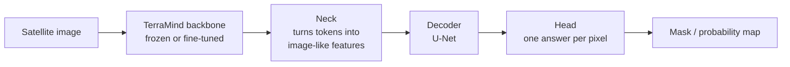
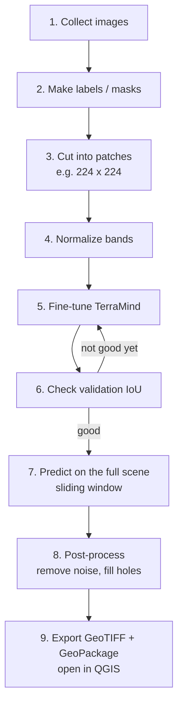

# Beginner's Guide: Geospatial Foundation Models (GeoFM) and TerraMind

This guide explains the basic ideas you need before you start your own project.
No deep math. Just the things I wish someone had told me on day one.

---

## 1. What is a "foundation model"?

A foundation model is a big model that has **already learned** from a huge amount of data.
You do not train it from zero. You take it and **teach it one small new job**. This is called *fine-tuning*.

Think of it like hiring someone who already reads maps very well.
You only need to show them a few examples of "this is a rice field", and they learn fast.

## 2. What is TerraMind?

**TerraMind** is a geospatial foundation model made by **IBM and ESA**.
It was trained on millions of satellite images from many sources (Sentinel-1 radar, Sentinel-2 optical, elevation, land cover, and more).

- Model card: https://huggingface.co/ibm-esa-geospatial/TerraMind-1.0-base
- Paper: https://arxiv.org/abs/2504.11171

TerraMind can read different kinds of input. Each kind is called a **modality**:

| Modality name | What it is |
|---|---|
| `S2L1C` | Sentinel-2, top of atmosphere, 13 bands |
| `S2L2A` | Sentinel-2, surface reflectance (atmosphere corrected) |
| `S1GRD` | Sentinel-1 radar (VV, VH) |
| `RGB` | Any normal red-green-blue image (useful for very high-resolution satellites like THEOS-2) |
| `DEM` | Elevation |

## 3. What is TerraTorch?

**TerraTorch** is the library that makes TerraMind easy to use.
It gives you ready-made parts: backbone, neck, decoder, loss, and training loop.

- Repo: https://github.com/torchgeo/terratorch
- Paper: https://arxiv.org/abs/2503.20563

You can use it in two ways (my repos show both):

1. **Config + command line**: write a YAML file, then run `terratorch fit -c config.yaml` (see the *flood* repo).
2. **Python API**: build the model in Python with `SemanticSegmentationTask` or `BACKBONE_REGISTRY` (see the *rice* and *building* repos).

## 4. The basic architecture (the same idea in every project)

- **Backbone** = the foundation model. It "understands" the image.
- **Neck** = an adapter. TerraMind outputs *tokens* (a bit like words). The neck turns them back into a 2D grid.
- **Decoder** = makes the grid bigger again, back to full image size.
- **Head** = gives the final answer for each pixel (for example building / not building).

## 5. The workflow you will repeat in every project

## 6. Words you will see a lot

| Word | Simple meaning |
|---|---|
| **Patch / tile** | A small square cut from a big image. A model cannot take a whole scene at once. |
| **Stride** | How far you move between patches. Smaller stride = more overlap = smoother result, but slower. |
| **Mask / label** | The "answer key" image. 1 = object, 0 = background. |
| **Normalization** | Rescaling pixel values so the model always sees numbers in a similar range. |
| **Freeze backbone** | Keep the TerraMind weights fixed and only train the decoder. Faster, and needs less data. |
| **Checkpoint** | A saved copy of your trained model (a `.ckpt` or `.pth` file). |
| **IoU** | Intersection over Union. The main score for segmentation. 0 = bad, 1 = perfect. |
| **Dice / F1** | Another overlap score, similar to IoU. |
| **Threshold** | The cut-off that turns a probability into yes/no. 0.5 is the default, but you can tune it. |
| **NoData** | Empty pixels around the image (often 0 or 65535). Always remove them. |
| **CRS** | Coordinate Reference System. The image and the mask must use the same CRS. |

## 7. Lessons learned (please read!)

1. **Use a GPU.** A Colab T4 is enough for small tests. L4 or A100 is much faster.
2. **Do not pin old package versions.** `numpy==1.26.4` worked with older TerraTorch but breaks newer TerraTorch (`ResolutionImpossible`). Let Colab keep its own PyTorch and NumPy.
3. **Restart the runtime after installing TerraTorch.** Otherwise the old packages stay loaded.
4. **Check image and mask alignment first.** They need the same width, height, CRS and transform. Most "my model learns nothing" bugs start here.
5. **Remove NoData areas** before making patches. Otherwise the model learns "black border = background".
6. **Balance your patches.** If 95% of patches have no buildings, the model learns to say "no building" everywhere. Keep roughly 1:1 positive and negative patches.
7. **Use Dice or Focal loss** when the object is small (buildings, roads, floods). Plain cross-entropy is not enough.
8. **Pick the checkpoint by the class IoU you care about** (for example `val/IoU_Flood`), not by overall accuracy.
9. **Calibrate the threshold** on the validation set. 0.5 is not always the best.
10. **Use overlapping windows + weighted blending** when predicting, to avoid visible tile lines.
11. **Save the normalization stats with the checkpoint.** Prediction must use exactly the same numbers as training.
12. **Copy your data to the Colab local disk** (`/content`) before training. Reading from Google Drive is slow.
13. **Hugging Face sometimes returns HTTP 504.** Add retry and caching. A free `HF_TOKEN` in Colab Secrets also helps.
14. **Pseudo-labels are not ground truth.** A high score against pseudo-labels does not mean the map is correct. Always check the result visually.

## 8. Where to go next

- TerraMind official repo and examples: https://github.com/IBM/terramind
- TerraTorch docs: https://ibm.github.io/terratorch/
- Sen1Floods11 dataset: https://github.com/cloudtostreet/Sen1Floods11
- QGIS (to open the results): https://qgis.org
